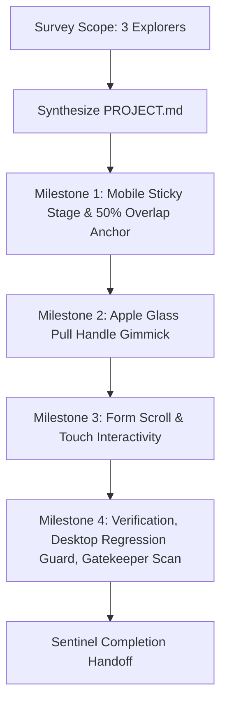

# Project Plan: Mobile Sticky Stage with 50% Overlap

## Objective
Implement mobile-specific layered floating glass bottom sheet and sticky overlap interaction where scrolling on mobile elevates the configurator card (.apple-glass-card) over the jersey preview stage by approximately 50%, featuring an Apple Glass pull handle (.mobile-sheet-handle) while preserving 100% desktop side-by-side layout and passing gatekeeper scan.

## Architecture Workflow



## Mobile UI Wireframe

```text
+-----------------------------------+
| Header Navigation (h: ~70px)      |
+-----------------------------------+
| STICKY JERSEY STAGE               |
| [Collar / Chest / 3D Canvas / No.]|
| Interactive top 50% exposed       |
+===================================+
| [ === Glass Pull Handle === ]     | <- Overlaps stage by ~50%
| ELEVATED GLASS CONFIGURATOR CARD  |
| - Email lookup                    |
| - Name & Number inputs            |
| - Size buttons & Slip upload      |
| (Scrollable internal form)        |
+-----------------------------------+
```

## Step-by-Step Execution Phases
1. **Phase 0: Survey & Codebase Reconnaissance**
   - Dispatch 3 parallel Explorers:
     - Explorer 1: Inspect HTML/JSX/component structure and jersey stage container layout.
     - Explorer 2: Inspect existing CSS/Tailwind classes, breakpoints, glass card styles, and mobile media queries.
     - Explorer 3: Inspect 3D Canvas / OrbitControls lifecycle, touch event bindings, and gatekeeper scan requirements.
   - Synthesize findings into `PROJECT.md`.
2. **Phase 1: Milestone 1 (M1) - Mobile Sticky Stage & 50% Overlap Anchor**
   - Iteration loop (Explorer -> Worker -> Reviewers -> Challenger -> Auditor).
   - Implement sticky positioning for jersey stage below header (`top: 70px`) on `< 1024px`.
   - Setup overlap anchor for `.apple-glass-card` to float over stage by ~50%.
3. **Phase 2: Milestone 2 (M2) - Apple Glass Pull Handle Gimmick**
   - Implement translucent Apple Glass pull handle pill (`.mobile-sheet-handle`) centered at top of configurator card.
   - Enforce Apple glass styling tokens (backdrop blur, subtle border, rounded pill).
4. **Phase 3: Milestone 3 (M3) - Form Scroll & Touch Interactivity**
   - Ensure internal form scrolling works cleanly without clipping or unwanted viewport bounce.
   - Verify 3D OrbitControls interactions in the visible top 50% stage work alongside form touch events.
5. **Phase 4: Milestone 4 (M4) - Zero Desktop Regressions & Gatekeeper Audit**
   - Verify desktop viewports (`>= 1024px`) remain strictly side-by-side.
   - Run `gk_gatekeeper_scan` and ensure complexity <= 7, span <= 50 lines, zero emojis, zero invariant violations.
   - Final audit verification and handoff to Sentinel.
